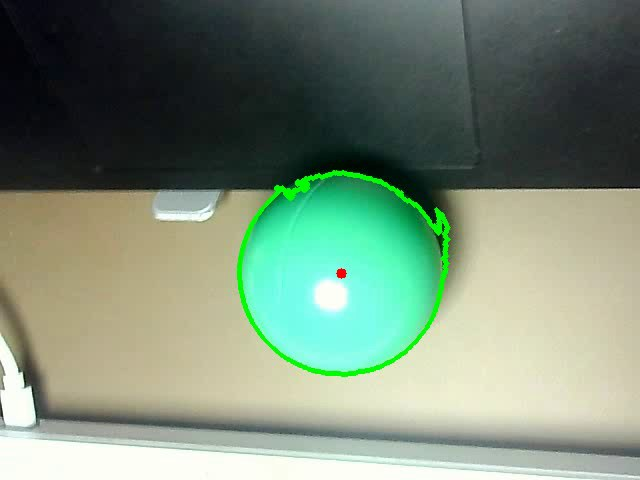
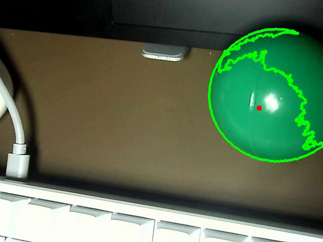
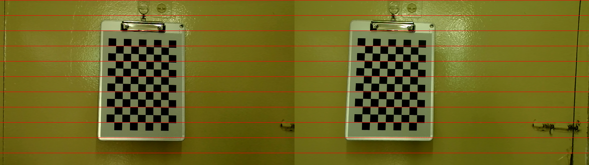
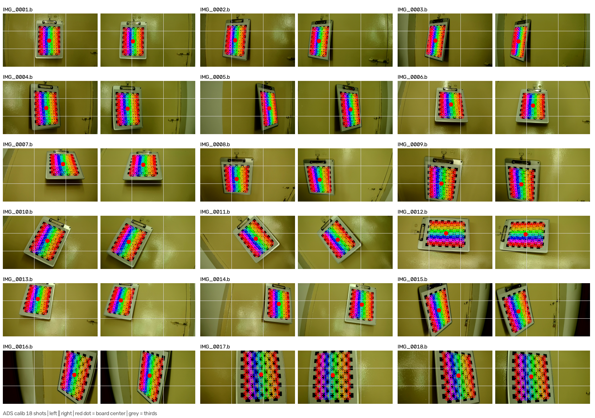

# ADS 低速目标拦截系统

个人独立项目。受 RoboMaster 启发，旨在用低成本硬件验证"感知 → 预测 → 拦截"的视觉算法。

---

## 演示：阶段一 · 单目视觉追踪

目标被轮廓锁定，红点标出质心（实时输出像素坐标）。




完整录屏（31 秒）：[video/output.avi](video/output.avi)

---

## 演示：阶段二 · 双目标定

18 张棋盘格标定图（3840×1080 BMP 无损），11×8 内角点，方格边长 20mm。

| 指标 | 实测值 |
|---|---|
| 单目重投影误差 | 左 0.475 px / 右 0.452 px |
| 基线 ‖T‖ | 118.243 mm（物理 120 mm，误差 1.46%） |
| 两镜头转角 | 0.682° |
| 极线校正后 y 偏差 | 平均 0.658 px，最大 2.165 px（18 张全统计） |

标定参数存于 [`src/calib_result.npz`](src/calib_result.npz)。

极线校正后，左右视图里同一个三维点应当落在大致相同的行上（红线是校验参考）：





---

## 最终目标

```
雷达扫描 → 检测到目标 → 视觉锁定 → 轨迹预测 → 计算拦截点 → 发射拦截 → 复位 / 继续搜索
```

---

## 项目进度

- [x] **阶段一**：单目视觉颜色追踪（输出像素坐标）—— 已完成
- [x] **阶段二（标定部分）**：双目相机标定 + 极线校正 —— 已完成
- [ ] **阶段二（测距部分）**：立体匹配与三维坐标输出 —— 待做（缺真实目标与稳定光照）
- [ ] **阶段三**：轨迹预测与决策子系统
- [ ] **阶段四**：发射器子系统
- [ ] **阶段五**：安装底盘 + 多场景复杂情况测试

---

## 技术栈

**语言与库**

- Python 3.13
- OpenCV 5.0（calib3d 模块：相机标定、立体校正、立体匹配）
- NumPy（矩阵与数值运算）

**硬件**

- USB 双目相机（3840×1080，MJPG 格式）
- Windows 平台，MSMF 采集后端

**算法**

- 已用：HSV 色彩空间、掩膜提取、轮廓检测与过滤、矩计算（质心定位）
- 已用：相机标定、畸变模型、立体校正、极线校正、重投影误差评估
- 在学：SGBM 立体匹配、三角测距、轨迹预测

**工程**

- Git / GitHub（版本管理）
- PyCharm
- VideoCap（相机参数配置与无损抓图）

---

## 目录结构

```
src/                           核心代码
  HSV_picker.py                HSV 阈值取色工具（滑动条 + 鼠标双击读取当前 HSV 值）
  Stage1_Single_Tracker.py     阶段一：单目视觉追踪（掩膜 → 轮廓 → 面积过滤 → 质心）
  Stage2_Camera_Setup.py       阶段二：双目相机初始化（MSMF + MJPG + 分辨率 + 曝光）
  Stage2_stereo_vision.py      阶段二：标定 + 极线校正（读图 → 角点 → 单目标定 → 双目标定 → remap）
  calib_result.npz             标定结果（内参、畸变、R、T、E、F）

docs/                          开发日志
  Project_YYYY.MM.DD.txt       开发日志（有进展或做出阶段性结果时记录）
  Stage1_summary.txt           阶段一小结
  对双目测距原理和去畸变原理的探讨.docx
  demo/                        演示截图

video/                         演示录像
```

---

## 运行环境

```
Python 3.13
opencv-python
numpy
```

需要连接 USB 双目相机（Windows 下使用 MSMF 后端，索引见脚本内注释）。

脚本里的路径都是相对的，请**在仓库根目录运行**：

```
python src/Stage2_stereo_vision.py
```


---

## 过程记录

```
docs/  ——  开发日志。不是每天都写，而是在有进展、
            或做出阶段性结果时记录，内容包括：
            当天进展 / 踩的坑 / 怎么解决的 / 自己犯的错
```

日志按日期排列（`Project_YYYY.MM.DD.txt`），可以直接顺着时间线看整个项目是怎么推进的。

---

## 后续计划

1. 立体匹配（SGBM）与 3 米 / 5 米测距精度验证（需要真实目标和稳定光照，宿舍的棋盘格代表不了真实场景）
2. 引入目标物（移动平台），验证"跟踪 + 测距 + 定位"整条链路
3. 轨迹预测与拦截点解算
4. 发射器与底盘集成
5. 多场景测试
